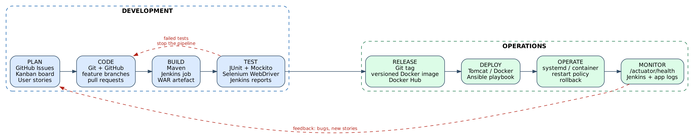
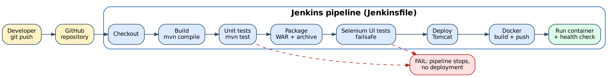

# 2. Agile Planning and DevOps Workflow (Task 3)

## 2.1 User stories and acceptance criteria

| ID | Story | Priority |
|----|-------|----------|
| US-01 | As a **customer**, I want to register an account so that I can book services | Must |
| US-02 | As a **customer or admin**, I want to log in and out so that my data stays private | Must |
| US-03 | As a **customer**, I want to see open slots with remaining seats so that I choose a time that is free | Must |
| US-04 | As a **customer**, I want to request a booking for my vehicle so that the workshop reserves a bay | Must |
| US-05 | As a **customer**, I want to see my bookings so that I know what I have booked | Must |
| US-06 | As an **admin**, I want to see all bookings so that I can plan the day | Must |
| US-07 | As an **admin**, I want to confirm a booking so that the customer knows it is accepted | Must |
| US-08 | As a **customer**, I want to cancel a booking so that the slot can be used by someone else | Must |
| US-09 | As a **customer**, I want to track my booking status so that I do not need to phone | Must |
| US-10 | As an **admin**, I want to mark a service completed so that the customer sees it is ready | Must |
| US-11 | As an **operator**, I want a health endpoint so that deployments can be verified automatically | Should |

### Acceptance criteria (Given / When / Then)

**US-01 Register**
- Given I am not registered, when I submit name, a valid e-mail and a password of at least 8 characters, then my account is created and I am sent to the login page with a success message.
- Given an e-mail is already registered, when I register with it again, then I see "already registered" and no second account is created.
- Given I leave a field empty or enter an invalid e-mail, then I see a field error and nothing is saved.

**US-02 Login / logout**
- Given valid credentials, when I log in, then I see my name in the header; admins land on the admin list, customers on the slots page.
- Given wrong credentials, then I stay on the login page with "Invalid email or password".
- Given I am logged out, when I open `/slots`, `/bookings` or `/admin/...`, then I am redirected to `/login`.

**US-03 View availability**
- Given I am logged in, when I open Available slots, then I see upcoming slots with date, time and remaining seats.
- Given a slot has no seats left, then it shows "Full" and no Book button.

**US-04 Request booking**
- Given a slot with seats, when I submit vehicle number, model and service type, then a booking with status REQUESTED is created and I see it in My bookings.
- Given the slot became full or is in the past, then the booking is rejected with a clear message.

**US-05 My bookings**
- Given I have bookings, then I see only my own, newest first, each with its status.

**US-06 / US-07 / US-10 Admin**
- Given I am an admin, when I open Admin bookings, then I see all bookings with customer, vehicle, slot and status.
- Given a REQUESTED booking, when I click Confirm, then its status becomes CONFIRMED.
- Given a CONFIRMED booking, when I click Complete, then its status becomes COMPLETED.
- Given I am not an admin, when I open an admin URL, then access is denied (403).

**US-08 Cancel**
- Given a REQUESTED or CONFIRMED booking of mine, when I cancel, then its status becomes CANCELLED and the slot's remaining seats increase by one.
- Given a COMPLETED or already CANCELLED booking, then it cannot be cancelled.

**US-09 Track status**
- Given a booking of mine, when I open its details, then I see the current status and a timeline with time stamps of each change.

**US-11 Health**
- Given the application is running with its database reachable, when I call `/actuator/health`, then the response is `{"status":"UP"}`.

## 2.2 Product backlog

| Rank | Item | Story | Size (points) | MoSCoW | Task |
|------|------|-------|---------------|--------|------|
| 1 | Repository, build, skeleton | - | 2 | Must | T-01 |
| 2 | User registration | US-01 | 3 | Must | T-02 |
| 3 | Login / logout | US-02 | 3 | Must | T-03 |
| 4 | Slot model + seeding | US-03 | 2 | Must | T-04 |
| 5 | Slot availability view | US-03 | 3 | Must | T-05 |
| 6 | Booking request form | US-04 | 3 | Must | T-06 |
| 7 | Booking rules | US-04 | 2 | Must | T-07 |
| 8 | My bookings | US-05 | 2 | Must | T-08 |
| 9 | Admin list / confirm / complete | US-06,07,10 | 5 | Must | T-09 |
| 10 | Cancel + release seat | US-08 | 3 | Must | T-10 |
| 11 | Status tracking | US-09 | 2 | Must | T-11 |
| 12 | Health + per-environment config | US-11 | 2 | Should | T-12 |
| 13 | Unit tests | - | 3 | Must | T-13 |
| 14 | Selenium UI tests | - | 5 | Must | T-14 |
| 15 | Jenkins, Docker, Ansible | - | 8 | Must | T-15 |
| 16 | E-mail / SMS notification | new | 5 | Could | post-MVP |
| 17 | Reschedule a booking | new | 3 | Could | post-MVP |
| 18 | Service history per vehicle | new | 5 | Won't (now) | post-MVP |
| 19 | CSRF protection and HTTPS | new | 5 | Should (next) | post-MVP |
| 20 | PostgreSQL / MySQL option | new | 3 | Could | post-MVP |

Total MVP size: 48 points.

## 2.3 Kanban board (15 tasks)

Columns and WIP limits: **To Do** (no limit) | **In Progress** (max 3) | **In Review** (max 2) | **Done**.
Create the same board in GitHub Projects (Board view) with one card per issue.

Board at the start of Sprint 1:

| To Do | In Progress | In Review | Done |
|-------|-------------|-----------|------|
| T-02 .. T-15 | T-01 | - | - |

Board at the end of Sprint 3 (all MVP tasks finished):

| To Do | In Progress | In Review | Done |
|-------|-------------|-----------|------|
| - | - | - | T-01, T-02, T-03, T-04, T-05, T-06, T-07, T-08, T-09, T-10, T-11, T-12, T-13, T-14, T-15 |

## 2.4 Sprint plan

Three one-week sprints (adjust the dates to your lab calendar).

| Sprint | Goal | Tasks | Points | Demo |
|--------|------|-------|--------|------|
| 1 | A user can register, log in and see open slots | T-01 .. T-05 | 13 | Register -> login -> slot list |
| 2 | Full booking lifecycle | T-06 .. T-11 | 17 | Book -> admin confirms -> track -> cancel |
| 3 | Quality and delivery pipeline | T-12 .. T-15 | 18 | Commit -> Jenkins -> tests -> Tomcat + Docker -> Ansible |

Ceremonies: sprint planning (30 min), daily 5-minute stand-up note in the issue, sprint review with demo,
retrospective (what went well / to improve / action).

## 2.5 Definition of Done

A task is **Done** only when all of the following are true:

- [ ] Code is on a feature branch and merged to `develop` through a reviewed pull request
- [ ] Acceptance criteria of the linked story are demonstrated
- [ ] Unit tests added or updated and `mvn test` is green
- [ ] Selenium journey updated if the user-visible flow changed and `mvn verify` is green
- [ ] Jenkins build on `develop` is green and the WAR is archived
- [ ] No secrets, local paths or generated files committed
- [ ] Documentation / README updated
- [ ] Deployed to the target environment and `/actuator/health` is `UP`
- [ ] Backlog and Kanban card updated

## 2.6 DevOps lifecycle: development to operations

| Phase | Activity in this project | Tools |
|-------|--------------------------|-------|
| Plan | User stories, backlog, Kanban, sprint plan | GitHub Issues, GitHub Projects |
| Code | Feature branches, commits, pull requests, review | Git, GitHub |
| Build | Compile, package WAR, archive artefact | Maven, Jenkins |
| Test | Unit tests, Selenium UI tests, reports | JUnit 5, Mockito, Selenium, Failsafe |
| Release | Tag, versioned Docker image, registry | Git tags, Docker, Docker Hub |
| Deploy | Copy WAR to Tomcat, run container, configure node | Jenkins, Docker, Ansible |
| Operate | Run as service / container, restart policy, rollback | systemd, Docker, Ansible |
| Monitor | Health checks, logs, build history -> new backlog items | Actuator, Jenkins |

### Commit-to-container flow

