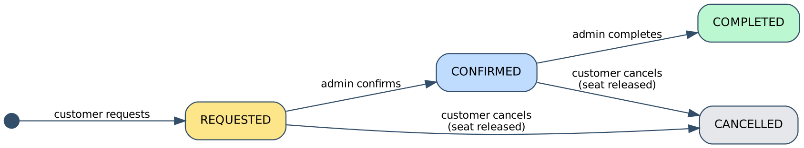
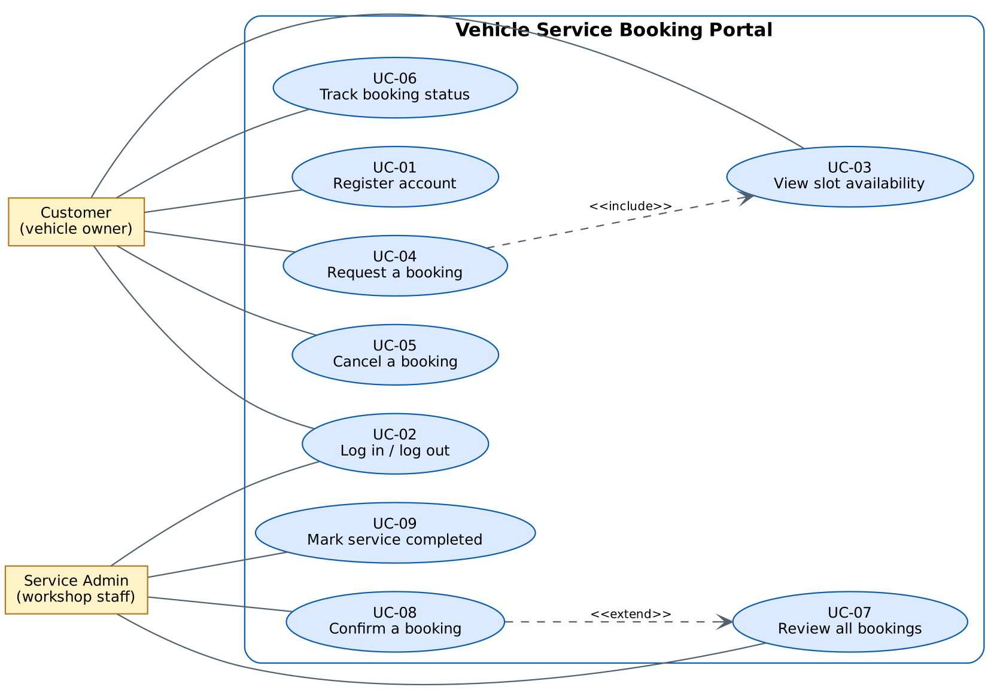
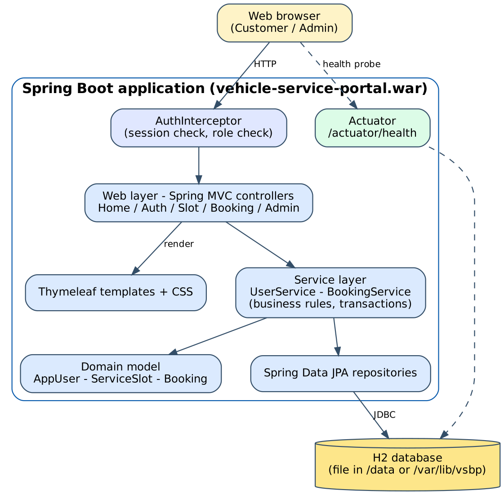
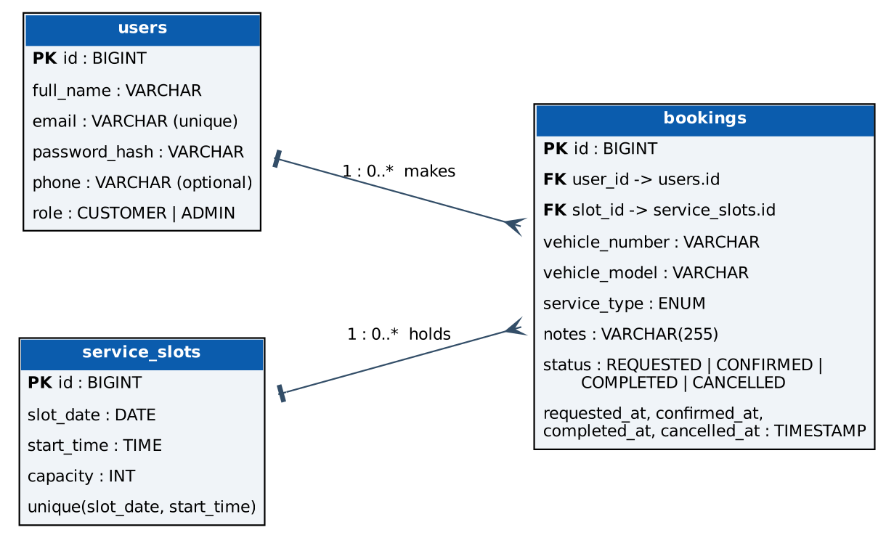

# 3. Requirements, Architecture and Technology Setup (Task 4)

## 3.1 SRS summary

### Purpose and scope
The portal lets customers view live slot availability and manage vehicle-service bookings, and lets the
workshop admin confirm and complete them. Scope and exclusions are in [section 1.8](01-problem-definition-and-scope.md).

### User classes
| Class | Characteristics |
|-------|-----------------|
| Customer | Registered via the portal; sees only own bookings |
| Admin | Seeded account (`admin@vsbp.local`); sees all bookings; confirms and completes |

### Functional requirements
| ID | Requirement | Story |
|----|-------------|-------|
| FR-01 | The system shall register a customer with name, unique e-mail and password (>= 8 chars) | US-01 |
| FR-02 | Passwords shall be stored only as BCrypt hashes | US-01 |
| FR-03 | The system shall authenticate users and keep a server-side session; logout shall invalidate it | US-02 |
| FR-04 | Pages for slots, bookings and admin shall require login; admin pages shall require the ADMIN role | US-02 |
| FR-05 | The system shall list upcoming slots with date, time and remaining seats | US-03 |
| FR-06 | The system shall create a booking (vehicle number, model, service type, notes) with status REQUESTED | US-04 |
| FR-07 | The system shall reject a booking for a full slot or a slot in the past | US-04 |
| FR-08 | A customer shall see only their own bookings | US-05 |
| FR-09 | An admin shall see all bookings | US-06 |
| FR-10 | An admin shall confirm a REQUESTED booking (-> CONFIRMED) | US-07 |
| FR-11 | An admin shall complete a CONFIRMED booking (-> COMPLETED) | US-10 |
| FR-12 | A customer shall cancel own REQUESTED or CONFIRMED booking (-> CANCELLED); the seat is released | US-08 |
| FR-13 | The system shall show status and a time-stamped timeline for each booking | US-09 |
| FR-14 | The system shall expose `/actuator/health` | US-11 |
| FR-15 | The system shall generate upcoming slots (next 7 days, 4 per day) automatically on start-up | US-03 |

### Non-functional requirements
| ID | Category | Requirement |
|----|----------|-------------|
| NFR-01 | Performance | Pages respond in < 1 s with up to 1 000 bookings on the lab machine |
| NFR-02 | Usability | Booking requires at most 6 interactions from the home page |
| NFR-03 | Security | BCrypt hashes, session id regenerated on login, authorisation on every protected route, input validation |
| NFR-04 | Reliability | Capacity is enforced under concurrent requests (pessimistic lock on the slot row) |
| NFR-05 | Portability | Runs on Tomcat 10.1, with `java -jar`, and in Docker; Java 17+ |
| NFR-06 | Maintainability | Layered packages; business rules in domain/service classes covered by unit tests |
| NFR-07 | Operability | Environment name visible in footer; configuration through environment variables |
| NFR-08 | Testability | Critical journeys automated with Selenium; failures produce screenshots |

### Business rules
- A booking uses one seat of a slot until it is CANCELLED.
- Allowed transitions: REQUESTED -> CONFIRMED -> COMPLETED; REQUESTED/CONFIRMED -> CANCELLED. Everything else is rejected.
- Only the owner may cancel a booking; only an admin may confirm or complete.



## 3.2 Use-case diagram



| UC | Name | Actor | Main flow |
|----|------|-------|-----------|
| UC-01 | Register account | Customer | Open Register -> submit form -> redirected to Login |
| UC-02 | Log in / out | Customer, Admin | Submit credentials -> session created |
| UC-03 | View slot availability | Customer | Open Available slots -> list with remaining seats |
| UC-04 | Request a booking | Customer | Choose slot -> enter vehicle details -> submit -> status REQUESTED |
| UC-05 | Cancel a booking | Customer | My bookings -> Cancel -> status CANCELLED, seat released |
| UC-06 | Track booking status | Customer | My bookings -> Details -> status and timeline |
| UC-07 | Review all bookings | Admin | Open Admin bookings |
| UC-08 | Confirm a booking | Admin | Confirm on a REQUESTED booking |
| UC-09 | Mark service completed | Admin | Complete on a CONFIRMED booking |

## 3.3 Architecture



A layered monolith: browser -> interceptor (authentication/authorisation) -> controllers -> services ->
repositories -> database. A monolith is the smallest architecture that satisfies the MVP and is the simplest
thing to build, test, containerise and deploy in a CI/CD lab.

### Technology choices
| Concern | Choice | Reason |
|---------|--------|--------|
| Language / framework | Java 17, Spring Boot 3.3 | Required Tomcat/Maven toolchain; mature testing support |
| View | Thymeleaf (server-side HTML) | No JavaScript build step; easy Selenium locators |
| Persistence | Spring Data JPA + H2 file DB | Zero installation; swap with `DB_URL` for MySQL/PostgreSQL later |
| Build tool | **Maven** | Convention-based; Jenkins and Failsafe integration |
| Packaging | WAR (executable) | Same file deploys to Tomcat or runs with `java -jar` |
| Deployment targets | **Tomcat 10.1** (WAR), Docker (`eclipse-temurin:17-jre-alpine`) | Both required by the lab tasks |
| Tests | JUnit 5, Mockito, Selenium 4 + Failsafe | Unit and UI test separation |
| CI/CD | Jenkins pipeline | Required by the lab |
| Configuration management | Ansible | Agentless, YAML, simple for one node |

### Deployment views
| Target | How | URL |
|--------|-----|-----|
| Local | `mvn spring-boot:run` | `http://localhost:8080/` |
| Tomcat (Jenkins deploy) | `webapps/vsbp-<env>.war` | `http://localhost:8081/vsbp-<env>/` |
| Docker | `docker run -p 9090:8080 ...` | `http://localhost:9090/` |
| Ansible node | systemd service `vsbp` | `http://<node>:8080/` |

## 3.4 Data model



## 3.5 Route / API list

All pages are server-rendered HTML. `Auth` = login required, `Admin` = ADMIN role required.

| Method | Path | Access | Purpose |
|--------|------|--------|---------|
| GET | `/` | Public | Home page |
| GET / POST | `/register` | Public | Registration form / submit |
| GET / POST | `/login` | Public | Login form / submit |
| POST | `/logout` | Auth | End session |
| GET | `/slots` | Auth | Slot availability list |
| GET | `/bookings/new?slotId={id}` | Auth | Booking form for a slot |
| POST | `/bookings` | Auth | Create booking (status REQUESTED) |
| GET | `/bookings` | Auth | My bookings |
| GET | `/bookings/{id}` | Auth (owner or admin) | Status and timeline |
| POST | `/bookings/{id}/cancel` | Auth (owner) | Cancel booking |
| GET | `/admin/bookings` | Admin | All bookings |
| POST | `/admin/bookings/{id}/confirm` | Admin | REQUESTED -> CONFIRMED |
| POST | `/admin/bookings/{id}/complete` | Admin | CONFIRMED -> COMPLETED |
| GET | `/actuator/health` | Public | Health probe (`{"status":"UP"}`) |

## 3.6 Working local setup (Windows / Linux / macOS)

1. **Install JDK 17** (Temurin or Oracle). Check: `java -version` shows 17 or higher.
2. **Install Maven 3.9+**. Check: `mvn -v`.
3. **Install Git**. Check: `git --version`.
4. Clone and run:
   ```bash
   git clone <your-repo-url>
   cd vehicle-service-portal
   mvn clean verify          # compile, unit tests, Selenium tests (needs Chrome)
   mvn spring-boot:run       # http://localhost:8080
   ```
5. Open <http://localhost:8080>, register a customer, log in, book a slot. Log in as
   `admin@vsbp.local` / `Admin@123` in a private window to confirm it.
6. Verify health: <http://localhost:8080/actuator/health> -> `{"status":"UP"}`.

### Tomcat 10.1 (needed from Task 9)
1. Download **Apache Tomcat 10.1.x** (zip). *Tomcat 9 will not work: Spring Boot 3 uses `jakarta.*`.*
2. Because Jenkins also uses 8080, change Tomcat's HTTP port to **8081** in `conf/server.xml`
   (`<Connector port="8081" ...>`).
3. Start it (`bin/startup.sh` or `bin\startup.bat`) and open <http://localhost:8081>.
4. Deploying by hand: copy `target/vehicle-service-portal.war` to `webapps/vsbp-dev.war` -> app appears at
   `http://localhost:8081/vsbp-dev/`.

### Configuration reference
| Setting | Environment variable | Default |
|---------|----------------------|---------|
| Environment label | `APP_ENVIRONMENT` (or `-Dapp.environment` at build) | `local` |
| Database URL | `DB_URL` | `jdbc:h2:file:./data/vsbp-<env>` |
| DB user / password | `DB_USER` / `DB_PASSWORD` | `sa` / empty |
| Admin e-mail / password (seeded once) | `APP_SEED_ADMIN_EMAIL` / `APP_SEED_ADMIN_PASSWORD` | `admin@vsbp.local` / `Admin@123` |
| Capacity of generated slots | `APP_SEED_SLOT_CAPACITY` | `3` |
| HTTP port (java -jar) | `SERVER_PORT` | `8080` |
